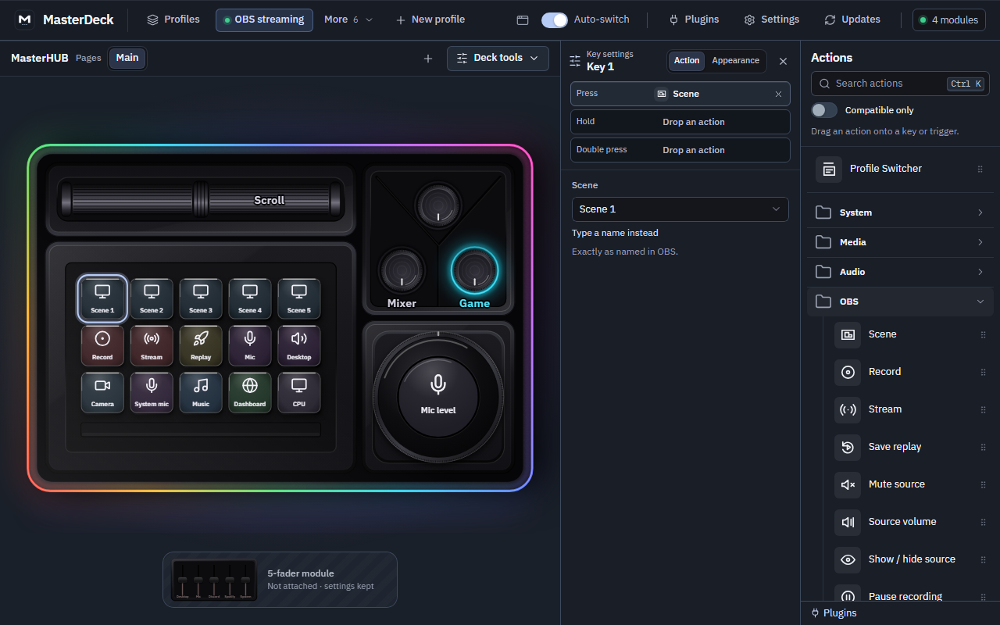
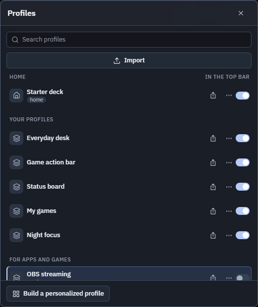
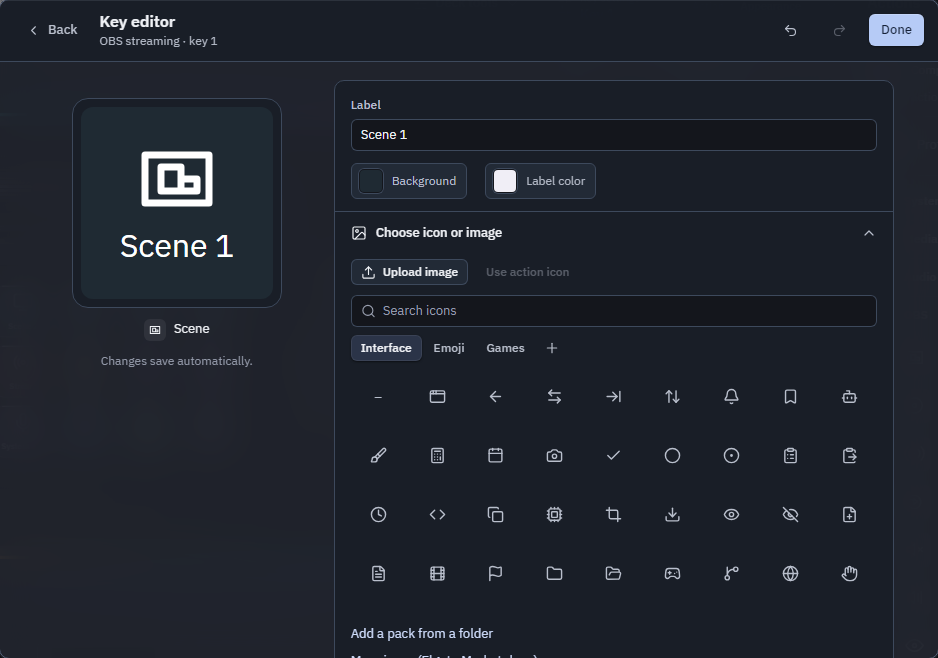
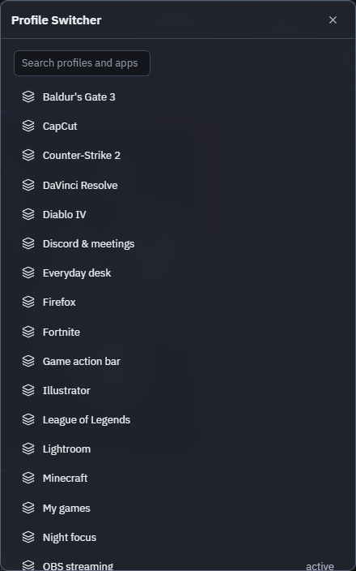
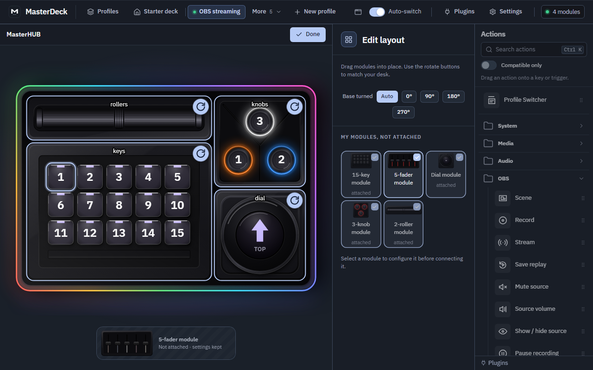
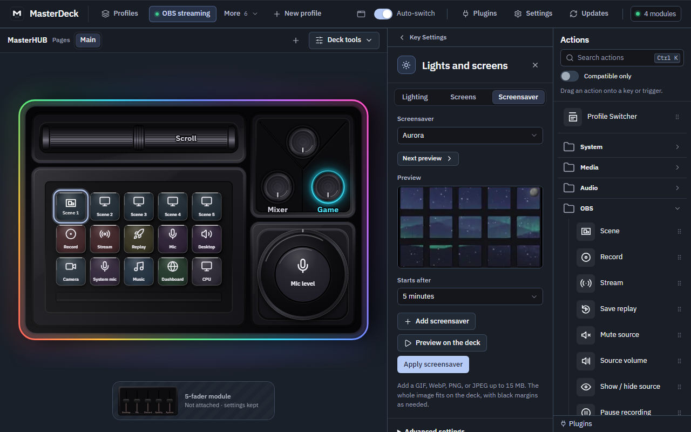
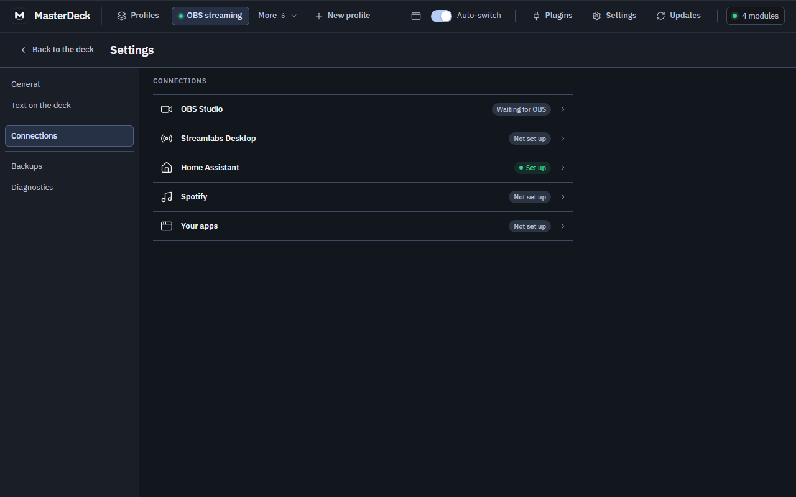
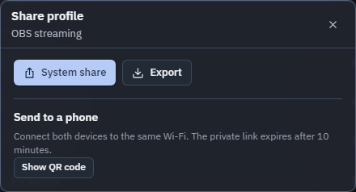
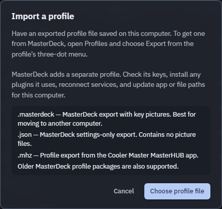
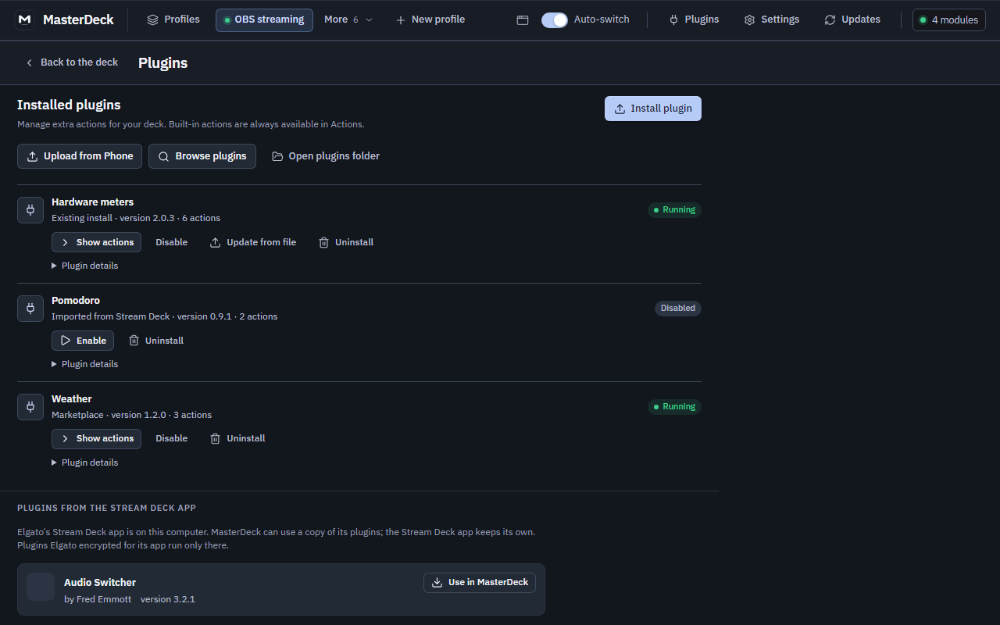

# MasterDeck

MasterDeck is a desktop editor for the Cooler Master MasterHUB. Build a workspace around the keys, dial, knobs, faders, and rollers you have. Assign actions, set up profiles for different apps, and see your changes on the deck preview as you work.

[**Download for Windows (.exe)**](https://github.com/kyawzin19997/coolermaster/releases/latest/download/MasterDeck-windows-x64-setup.exe) · [Download for macOS (.dmg)](https://github.com/kyawzin19997/coolermaster/releases/download/v1.4.0/MasterDeck-macOS-Universal.dmg) · [All releases](https://github.com/kyawzin19997/coolermaster/releases)

## Install and connect

- **Windows 10 or 11, x64.** Run the setup file and open MasterDeck from Start. Setup includes the offline WebView2 runtime and can create a desktop shortcut. Use **Updates** in the toolbar to check for a newer Windows release.
- **macOS 12 or newer.** Open the universal DMG and drag MasterDeck into Applications. macOS may ask for first-launch approval in **System Settings → Privacy & Security**. Allow Accessibility if you use actions that type or send shortcuts.

Quit the official MasterHUB app before connecting the hardware. One application controls the deck at a time.

## Set up your deck

1. Open **Profiles → Build a personalized profile** to set up a profile for what you do most. You can also start it from **Settings → General**.
2. Expand a category in **Actions** and drag an indented action onto a key. Click the key to open **Key Settings**, then drag onto **Hold** or **Double press** to add another action.
3. Open **Profiles** to start from a template or create a profile. Click **+** beside the page tabs to add a page. To delete one, select its tab and press **Delete**.
4. Right-click a key to copy or paste it. Replacing an action also replaces its icon and keeps the key’s styling.

See the profile library

## Customize a key

Select a key and open **Appearance → Full editor**. Under **Choose icon or image**, use **Upload image** for a file from your computer, browse the icon library, or restore the action’s icon. Use **Position on the key** to resize or move the icon. Under **Styles and effects**, pick a preset and optional motion. **More style controls** opens the detailed editor.

## Switch profiles from a key

Drag **Profile Switcher** from Actions onto a key. Press the physical key to open the profile list, then press it again to close the list. You can try it from the preview by right-clicking the assigned key and choosing **Profile Switcher**. Use **Switch profile** to jump directly to a specific profile or cycle through them.

## Match the layout to your desk

Open **Deck tools → Edit layout**. Drag and rotate the connected modules until the drawing matches your desk. To configure a module before connecting it, select it under **My modules, not attached**, choose **Done**, and drag an action onto one of its controls below the deck.

See Edit layout

## Set a screensaver

Open **Deck tools → Screensaver**, then use **Next preview** to browse before saving. Use **Add screensaver** to import a GIF, WebP, PNG, or JPEG up to 15 MB. Set the idle delay and select **Apply screensaver**. **Advanced settings** controls which profiles use it and what the dial and lights do. Click a key at any time to return to its settings.

See Screensaver settings

## Connect OBS Studio

Open OBS Studio on the same computer. MasterDeck finds the local OBS connection and reconnects when OBS restarts. You can check the connection under **Settings → Connections → OBS Studio**. If MasterDeck shows **Setup needed**, close OBS Studio, choose **Enable connection** in MasterDeck, and reopen OBS. For OBS on another computer or a custom installation, expand **Manual connection**.

In OBS Studio Mode, select a scene key and choose **Preview** to cue a scene or **Program** to switch the live output. The target appears on the deck preview. A key set to Preview requires Studio Mode, so it cannot accidentally switch the live output outside Studio Mode.

See Settings → Connections

## Use a profile on another deck

1. Open **Profiles** and click the **Share** icon beside a profile.
2. Choose **System share** for your operating system’s share options, **Export** to save a file, or **Show QR code** to download it from another device on the same Wi-Fi. The QR link expires after 10 minutes.
3. On the destination computer, open **Profiles → Import → Choose profile file** and select the `.masterdeck` file. Review plugin requirements, linked apps, and action paths. [Profile transfer guide](docs/profile-transfer.md)

See Share and Import

## Plugins and phone uploads

Open **Plugins → Install Plugin** to review a compatible plugin package before installing it. Enable it from the installed list to make its actions available. **Upload from Phone** pairs a phone browser using a QR code and desktop approval. You can send profiles, plugins, and images over your local Wi-Fi. [Phone upload guide](docs/phone-uploads.md)

See the installed plugins list

## Work on MasterDeck

The desktop app uses Tauri and Rust, with a React interface. The [contributing guide](CONTRIBUTING.md) covers setup and tests. See the [architecture](ARCHITECTURE.md), [GitHub beginner guide](docs/github-for-beginners.md), and [Windows release guide](docs/windows-release.md) for development and releases.

MasterDeck is independent of Cooler Master and builds on HubDeck by Przemysław Tarkowski. The code is available under the [MIT License](LICENSE) or [Apache License 2.0](LICENSE-APACHE). [License and credits](docs/licensing.md) · [Security](SECURITY.md) · [Privacy](PRIVACY.md)
